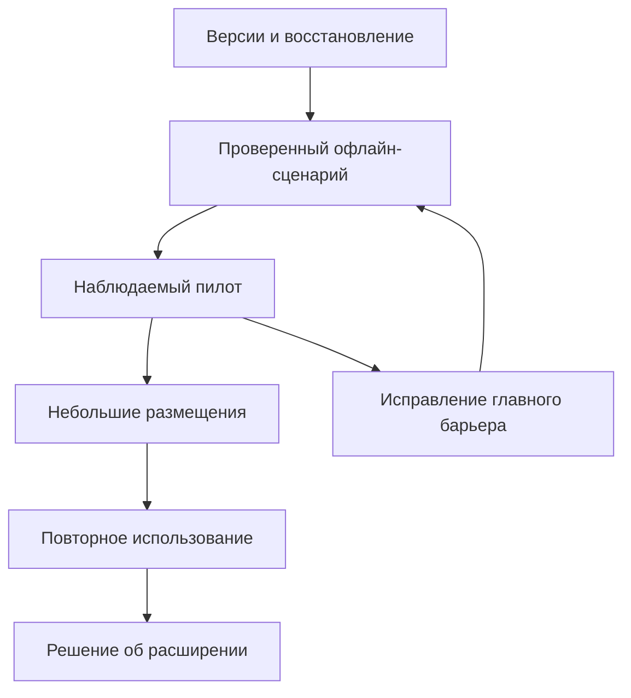

# KinoTime — план развития

Срез: 27.09.2026. План: 28.09–26.12.2026. Основной фокус: **кино на телефоне и планшете, заранее сохранённое для просмотра без интернета**.

## С чего начать

Прочитать [[01 Итог анализа]], затем [[04 План на 90 дней]]. Выбрать первые три задачи в [[05 Очередь задач]]. Это хранилище не требует сторонних плагинов.

## Карта знаний

- [[02 Карта готовности]] — что уже существует и где пробелы.
- [[03 Продукт и пользовательский путь]] — что должно получаться у человека.
- [[06 Техническое развитие]] — данные, версии, архитектура и проверки.
- [[07 Каталог и импорт]] — наполнение и ручная работа.
- [[08 Метрики и эксперименты]] — как отличать пользу от активности.
- [[09 Привлечение без бюджета]] — согласованные размещения и рекомендации.
- [[10 Риски и восстановление]] — база, файлы и зависимость от платформы.
- [[11 Экономика и решения]] — расходы и условия продолжения.
- [[12 Рабочий ритм]] — обязанности и недельный обзор.
- [[13 Источники и границы анализа]] — доказательства и неизвестное.
- [[14 Файлы проекта]] — переход к исходникам.

## На этой неделе

- [ ] Зафиксировать версии production и лаунчера.
- [ ] Проверить восстановление копии.
- [ ] Пройти офлайн-сценарий на Android и iPhone.
- [ ] Записать исходные данные, не подменяя неизвестное нулями.

## Шаблоны

[[Шаблон недели]] · [[Шаблон эксперимента]] · [[Шаблон проверки устройства]]

